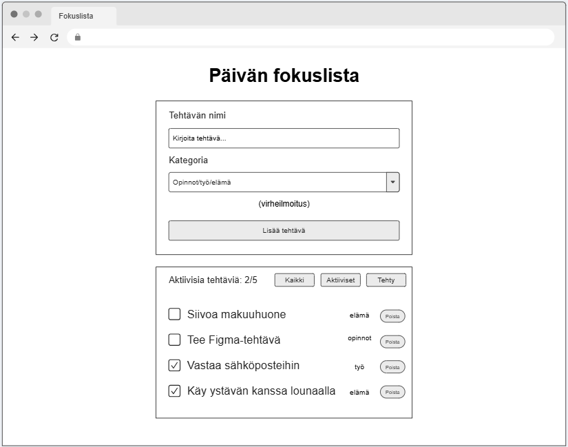
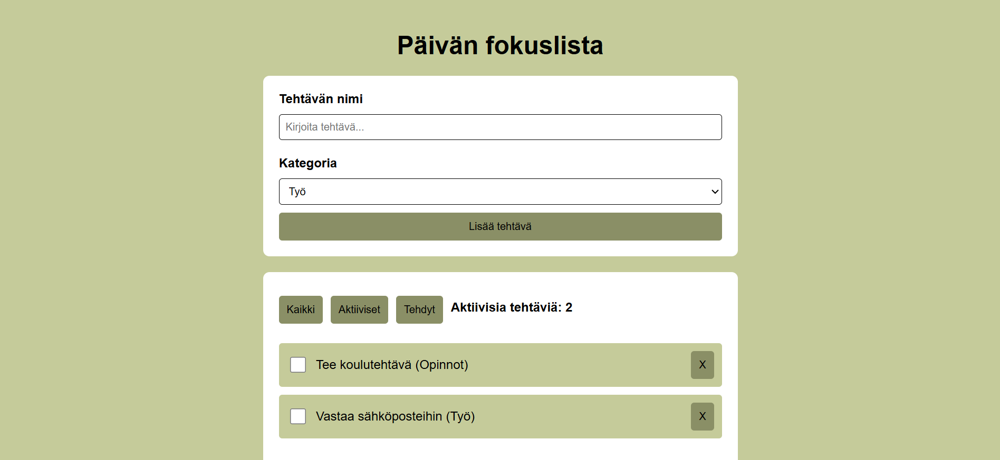
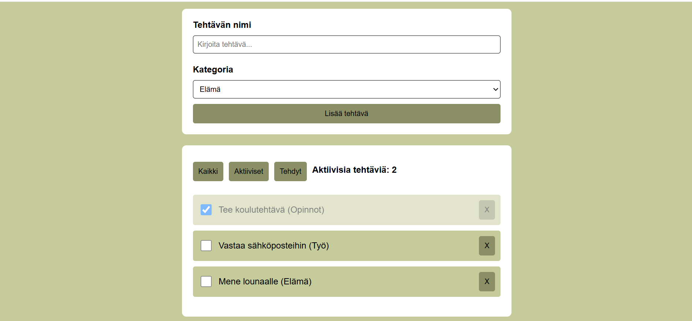
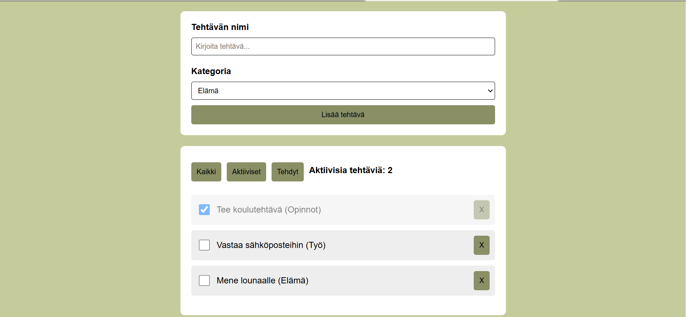
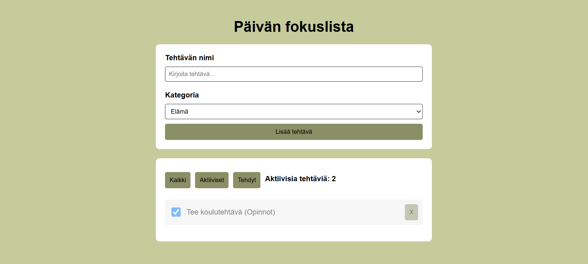

# Päivän fokuslista

**Tekijä:** Mikaela Grundström

## Projektisuunnitelma

### Projektin idea

Päivän fokuslista on yksinkertainen to-do-lista, jota käyttäjä voi käyttää hallitakseen päivän tärkeimpiä tehtäviä. Käyttäjä voi lisätä tehtäviä eri kategorioihin, merkitä niitä tehdyksi, poistaa niitä ja suodattaa listaa halutessaan. Sovellus on tarkoitettu kaikille, jotka tarvitsevat vähän tukea arjen hallintaan, esimerkiksi opiskelijoille.

### Suunnitellut toiminnot

- Tehtävän lisääminen lomakkeella
- Tehtävän merkitseminen tehdyksi
- Tehtävän poistaminen
- Suodatusnapit
- Laskuri aktiivisille tehtäville
- Tallennus localStorageen

### Rautalankamalli / luonnos

## Verkkolinkit

- **Julkaistu sovellus:** [GitHub Pages](https://mikaelalinnea.github.io/fokuslista/)
- **GitHub-repositorio:** [Repositorio](https://github.com/mikaelalinnea/fokuslista)
- **Projektin videoesittely:** [Video](https://example.com/)

## Tietoja sovelluksesta

**Päivän fokuslista** on verkkosovellus, jossa käyttäjä voi hallita päivän tehtäviä. Sovelluksessa voi lisätä uusia tehtäviä kolmessa eri kategoriassa: työ, opinnot sekä elämä. Lisättyään tehtävän, se siirtyy listaan jossa käyttäjä pystyy merkitä ne tehdyiksi, poistaa niitä ja suodattaa (Kaikki/Aktiiviset/Tehdyt). Tehtävät tallentuvat localStorageen, jotta ne säilyvät sivulla.

## Teknologiat

Kuvaile, mitä teknologioita käytit ja mikä niiden rooli oli projektissasi.

- HTML – sivun rakenne, lomake ja tehtävälista
- CSS – ulkoasu, värit, asettelu ja responsiivisuus
- JavaScript – sovelluksen toiminnallisuus, DOM-skriptaus, tapahtumien käsittely ja validointi
- localStorage – tehtävien tallentaminen selaimeen, jotta ne säilyy päivityksen jälkeen

## Sovelluksen käyttö

1. Avaa julkaistu sovellus selaimessa.
2. Kirjoita tehtävän nimi ja valitse kategoria.
3. Paina lisää tehtävä.
4. Tehtävän voi merkitä tehdyksi checkboxilla.
5. Tehtävän voi poistaa X-painikkeella.
6. Tehtävät voi suodattaa: Kaikki, Aktiiviset, Tehdyt.

## Sovelluksen käynnistäminen paikallisesti

1. Kloonaa tai lataa tämä repositorio omalle koneellesi.
2. Avaa projektikansio.
3. Avaa `index.html` selaimessa.

## Kuvakaappaukset

## Tunnetut virheet / puutteet

Ei tunnettuja virheitä.

## Oma arvio ja oppimisen reflektointi

Pohdi työtäsi ja oppimisprosessiasi.

- Sain tehtävälistan toimimaan niin kuin halusin, lisääminen, suodatus, merkitseminen tehdyksi ja poistaminen toimii. 
- Haastavinta oli soveltaa kurssin aikana (tai aikaisemmin) opittuja asioita, jotta ne sopisivat tähän projektiin ja saisin kaiken toimimaan niin kuin halusin.
- Jos olisi enemmän aikaa, haluaisin lisätä mahdollisuuden muokata listassa olevia tehtäviä ja mahdollisuuden järjestää tehtävät esimerkiksi tärkeyden mukaan.
- HTML: opin paremmin rakentamaan sivulle selkeän rakenteen. CSS: Opin paremmin käyttämään luokkia tilojen hallintaan. JavaScript: opin käsittelemään käyttäjän syötteitä, tallentamaan ja hakemaan dataa localStoragella, käyttämään JSON-metodeja ja tekemään suodatuksia. Opin myös hallitsemaan sovelluksen tilaa taulukon avulla. DOM-skriptaus: Opin luomaan elementtejä, muokkaamaan niiden sisältöä ja rakentamaan listan uudelleen kun lista muuttuu.
- En koe minkään jääneen epäselväksi, haluaisin vain ylipäätään oppia lisää JavaScriptistä sekä DOM-skriptauksesta.
- Oma arvio projektista: **8/10 pistettä**

## Lähteet ja kiitokset

- Kurssimateriaali & aikaisemmat workshopit.
- [MDN - Date.now()](https://developer.mozilla.org/en-US/docs/Web/JavaScript/Reference/Global_Objects/Date/now)
- [MDN - String.prototype.includes()](https://developer.mozilla.org/en-US/docs/Web/JavaScript/Reference/Global_Objects/String/includes)

- Käytetty tekoälytyökalu: Microsoft Copilot
  - Tekoälyä on käytetty koodin virheiden etsimiseen jos jokin toiminto ei toiminut oikein sekä koodin siistimiseen. 

  ## Lisenssi

Tämä projekti on lisensoitu MIT-lisenssillä.